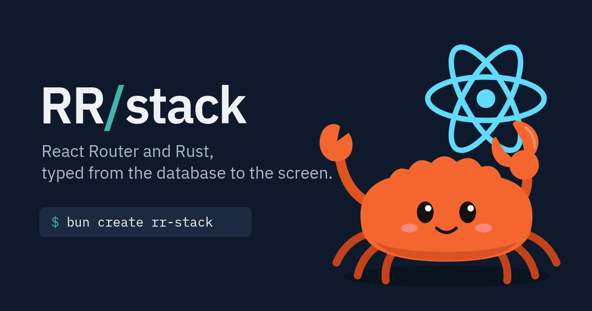
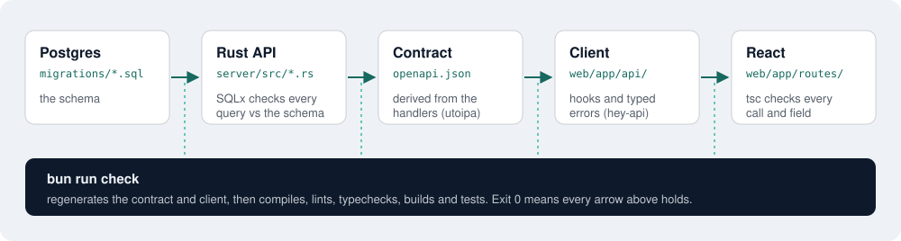
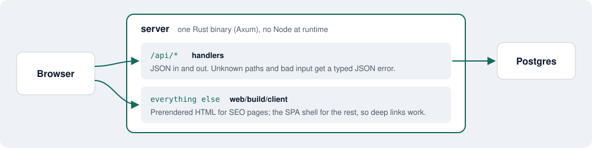

<h1>RR stack</h1>

<p>
  <a href="https://www.npmjs.com/package/create-rr-stack"></a>
  <a href="https://github.com/Useless007/rr-stack/actions/workflows/ci.yml"></a>
  <a href="LICENSE"></a>
</p>

[English](README.md) · [ไทย](README.th.md) · [简体中文](README.zh-CN.md) · **日本語**

React Router + Rust (Axum)。データベースから画面まで、型がつながったスターターです。

<p><a href="https://rrstack.vercel.app"></a></p>

```bash
bun create rr-stack my-app
```

**ライブデモ：[rrstack.vercel.app](https://rrstack.vercel.app)**。`bun create rr-stack --ssr` で作ったアプリを手を加えずに Vercel で動かしています。誰でも登録して todo を追加できるので、内容は公開され、毎日消去されます。

RR stack は、AI エージェントがコードを書き、人がレビューするアプリのためのスターターです。
「終わった？」に答えるコマンドは `bun run check` ひとつだけ。終了コードが 0 なら、SQL、Rust API、
OpenAPI のコントラクト、React のコードがすべて一致しています。Windows、macOS、Linux で同じように
動きます。

## なぜ必要か

AI エージェントが持ち込むバグの多くは、2 つの層の食い違いです。列名を変えたのにクライアントが古い
フィールドを送っている、誰も処理しないエラー形式がある、など。RR stack はそれらをすべて
コンパイル時に検出します。

| 層 | ツール | 誰がチェックするか |
|---|---|---|
| データベース | Postgres + SQLx `query!` | Rust コンパイラが実際のスキーマと照合 |
| API | Axum + utoipa | `openapi.json` はハンドラから自動生成 |
| コントラクト | `openapi.json` | `bun run check` のたびに再生成して差分を確認 |
| クライアント | hey-api + TanStack Query | 型付きエラーも含めてコントラクトから生成 |
| UI | React Router（`prerender` + SPA、または `--ssr` での `ssr: true`） | `tsc` とフルビルド |

デフォルトでは本番は 1 プロセスだけです。Axum が API とビルド済みのページを配信し、実行時に Node は不要です。
`bun create rr-stack my-app --ssr` で作ると、すべてのページをサーバーでレンダリングし、Axum の後ろに bun のプロセスが 1 つ加わります。

## 仕組み





## AI にゼロから作らせればよいのでは？

AI エージェントは空のフォルダからこれをすべて書けます。自分でできないのは、いつ完成したかを知ることです。
コンパイルが通れば止まり、残りの問題はあなたが見つけることになります。ここでは「完成」は本当に失敗する
2 つのコマンドで、以下はどれも推測ではなく実際に測ったものです。

- **壊れたページは出荷前に止まる。** わざと 3 つのバグを入れました：hydration の不一致、保存時に 1 文字
  消える、名前の変わったボタン。`bun run e2e` はそれぞれで失敗し、ページのスクリーンショットを残しました。
- **同じコードが自分のサーバーでも Vercel でも動く。** ブラウザテスト一式が Vercel の本番環境で 11 件中
  11 件通りました。通常のアプリと `--ssr` のアプリの両方で、リアルタイム更新も含みます。
- **プッシュのたびに、利用者と同じ使い方でテストする。** CI は Linux と Windows で `check`、`smoke`、
  `e2e` を実行し、4 つの構成（SPA か SSR、Tailwind か Astryx）をすべて生成して確認し、本番構成を
  Caddy 経由の HTTPS で動かします。
- **層どうしが黙ってずれることはない。** 列名を変えれば Rust のビルドが失敗し、ハンドラを変えれば契約の
  差分チェックが失敗し、TypeScript クライアントは常に再生成され、手で編集されることはありません。

## 自分で組み合わせればよいのでは？

もちろんできます。どの部品も一般的で人気のあるライブラリです。時間がかかるのはそれらをつなぐ部分で、
このリポジトリが提供するのはまさにそこです。

| 自分でやるなら | RR stack に含まれるもの |
|---|---|
| サーバーを起動せずに Rust から OpenAPI spec を出力する | `cargo run --bin openapi`。サーバーと同じ router から生成 |
| TS クライアントと react-query hooks を生成し、ずれたら CI を失敗させる | `bun run gen` と `bun run check` のコントラクト差分チェック |
| データベースなしで CI と Docker で Rust をビルドする | コミット済みの `.sqlx/` オフラインクエリメタデータ |
| 不正な入力や未知のルートに、プレーンテキストではなく型付き JSON を返す | `AppJson`、`AppPath`、`AppQuery` と JSON 404/405 |
| プリレンダリングしたページ、SPA、API を 1 つのバイナリで配信する | SPA フォールバック付きの Axum。ディープリンクもテスト済み |
| 検索エンジンに見つけてもらい、共有時にカードを表示する | canonical、Open Graph カード、`sitemap.xml`、`robots.txt` を公開ページの一覧 1 つから生成。非公開ページは `noindex`、`--ssr` では本当の 404 |
| コンパイルだけでなく、実際のブラウザでページを確認する | `bun run e2e`：bun 上の Playwright（Node 不要）が全ページを開き、登録から削除までを操作。JS エラー、hydration の不一致、5xx があれば失敗し、スクリーンショットを残す |
| HTTPS 付きで公開する：自分のサーバーでも Vercel でも | `compose.prod.yml` が Caddy（証明書を自動取得）を追加し、80 と 443 以外を閉じる。Vercel では同じイメージを Neon データベースで動かし、リアルタイムも動く。`bun run e2e --url` で本番サイトを検証。[DEPLOY.md](https://github.com/Useless007/rr-stack/blob/main/DEPLOY.md) |
| Windows と Linux で同じコマンドを使う | bun スクリプト、LF 改行、両 OS での CI |
| AI エージェントに「完了」の定義と触ってはいけないファイルを伝える | `AGENTS.md` とひとつのチェックコマンド |
| 最初から安全なサインイン | Argon2id ハッシュ、HttpOnly SameSite cookie、ハッシュ化したセッショントークン、SQL での所有者チェック |
| 開いているページに変更を届ける | メッセージ型がコントラクトにある WebSocket。クライアントも型付き |
| すべてを 1 コマンドで起動する | `bun run dev`、または `docker compose up -d` |

どの行も初回はドキュメントを読んで試行錯誤するのに数時間かかり、しかも気づきにくい形で間違えがちです。
CI で再生成されないクライアントや、`/api/typo` に HTML を返すフォールバックなどです。ここではどの行にも
テストがあります。

**さらに広げるには**

- コンポーネントライブラリが欲しい場合は `--astryx` を付けると、アプリのページが
  [Astryx](https://github.com/meta/astryx)（Meta の React デザインシステム、beta）で作られ、Tailwind と併用されます。
- 検索エンジンに見せたいページは、`web/app/seo.ts` の `publicPages` にパスを追加し、`meta` から
  `seo(...)` を返します。canonical と共有カード付きの静的 HTML として配信され、`sitemap.xml` にも
  載ります。最初の HTML に訪問者ごとのデータを入れたい場合は `--ssr` でアプリを
  作ると、ルートの `loader` がサーバーで実行されます（todo ページが例です）。
- 別の言語のバックエンドがすでにある場合も、Web 側が読むのは `openapi.json` だけです。OpenAPI spec を
  出せるバックエンドなら、同じ生成クライアントと hooks を使えます。
- Rust が初めてでも大丈夫です。コードはエージェントが書き、コンパイラが直す場所をエージェントに伝え、
  `bun run check` が完了をあなたに伝えます。

## クイックスタート

```bash
bun create rr-stack my-app
cd my-app
docker compose up -d     # ツールチェーンなしでアプリ全体を起動。URL は CLI が表示します
# 開発する場合:
bun run dev              # Docker の Postgres + Rust API + Vite（ホットリロード付き）
```

新しいプロジェクトは、このスタック自体を紹介する小さな動くサイトです。プリレンダリングされた
ページ、コントラクトから作られた API リファレンス、サインイン、そして CRUD・絞り込み・検索・楽観的更新・
WebSocket によるリアルタイム更新・型付き 401/403/404/422 エラーをすべて備えた playground が入っています。日々の流れはプロジェクトの
`README.md` と `AGENTS.md` を読んでください。

必要なもの：Docker。開発する場合は Rust（stable）、[bun](https://bun.sh) 1.4+、git、
`cargo install sqlx-cli --no-default-features --features postgres,rustls` も必要です。

本番で動いているアプリを RR stack に移しますか？ [docs/migrate-an-existing-app.md](https://github.com/Useless007/rr-stack/blob/main/docs/migrate-an-existing-app.md)
に、ユーザーの再ログインもデータの欠落もなく一度で切り替える手順と、その事前リハーサルの方法があります（英語）。

## このリポジトリについて

このリポジトリは 2 つの役割を兼ねています。

- **テンプレート。** `cli/` と `docs/` 以外はすべて動く RR stack プロジェクトで、
  `bun create rr-stack` がコピーする中身そのものです。生成されたプロジェクトと同じように実行・
  テスト・変更できます。
- **CLI。** `cli/` は npm の `create-rr-stack` パッケージです。公開時にテンプレート（git が追跡する
  ファイルのみ）と、`cli/project-readme.md` のプロジェクト用 README を同梱します。

```
server/                Rust API（Axum、utoipa、SQLx）と結合テスト
web/                   React Router アプリ。web/app/api/ は生成コード
scripts/               bun run dev / check / smoke / e2e / gen を支える bun スクリプト
cli/                   create-rr-stack：index.ts（対話）、scaffold.ts（コピーと名前変更）、テスト
openapi.json           生成されたコントラクト
.github/workflows/     Linux と Windows の CI、docker compose。新しいプロジェクトにもコピーされます
```

## コントリビュート

人からも、人の代わりに働くエージェントからも歓迎します。まず [CONTRIBUTING.md](CONTRIBUTING.md)
（英語）を読んでください。要点は次のとおりです。

1. バグ修正より大きな変更は、先に issue を立てて方向性をすり合わせてください。
2. `bun run check` は終了コード 0 で終わる必要があります。CI が Linux と Windows で実行します。
3. テンプレートを変更した場合は、`cli/` で `bun test` も実行してください。プロジェクトを生成して
   チェックします。
4. 英語版が原文です。翻訳が追いついていない場合は、更新が必要な言語を PR に書いてください。

## ライセンス

[MIT](LICENSE)
