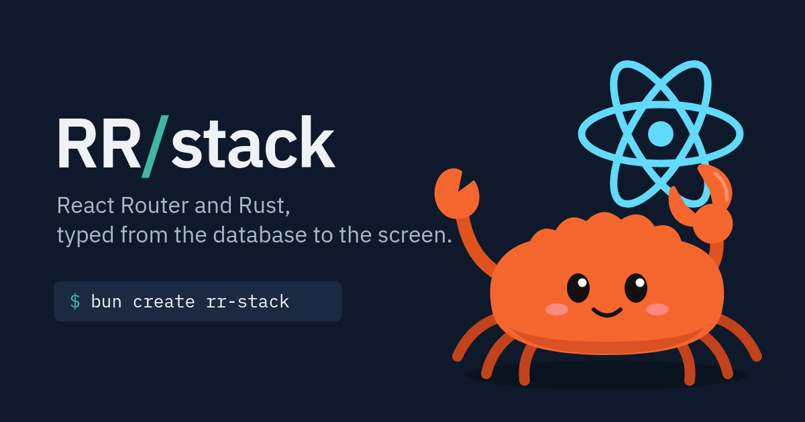
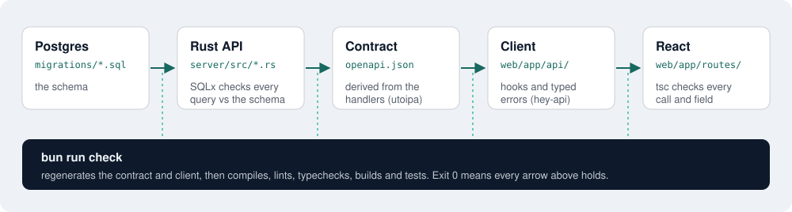
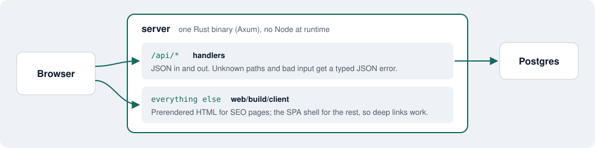

<h1>RR stack</h1>

<p>
  <a href="https://www.npmjs.com/package/create-rr-stack"></a>
  <a href="https://github.com/Useless007/rr-stack/actions/workflows/ci.yml"></a>
  <a href="https://github.com/Useless007/rr-stack/blob/main/LICENSE"></a>
</p>

**English** · [ไทย](https://github.com/Useless007/rr-stack/blob/main/README.th.md) · [简体中文](https://github.com/Useless007/rr-stack/blob/main/README.zh-CN.md) · [日本語](https://github.com/Useless007/rr-stack/blob/main/README.ja.md)

React Router + Rust (Axum), typed from the database to the screen.

<p><a href="https://rrstack.vercel.app"></a></p>

```bash
bun create rr-stack my-app
```

**Live demo: [rrstack.vercel.app](https://rrstack.vercel.app)**, an unmodified `bun create rr-stack --ssr` app on Vercel. Anyone can sign up and add todos there, so what you see is public and emptied every day.

RR stack is a starter for apps that AI agents write and people review. One command,
`bun run check`, answers "is it done?". If it exits 0, the SQL, the Rust API, the OpenAPI
contract and the React code agree with each other. It runs the same on Windows, macOS and Linux.

## Why

Most bugs an AI agent ships are two layers disagreeing: a renamed column, a field the client still
sends, an error shape nobody handles. RR stack moves each of those to compile time:

| Layer | Tool | Checked by |
|---|---|---|
| Database | Postgres + SQLx `query!` | the Rust compiler, against the real schema |
| API | Axum + utoipa | `openapi.json` is derived from the handlers |
| Contract | `openapi.json` | regenerated and diffed on every `bun run check` |
| Client | hey-api + TanStack Query | generated from the contract, including typed errors |
| UI | React Router (`prerender` + SPA, or `ssr: true` with `--ssr`) | `tsc` and a full build |

By default production is one process: Axum serves the API and the built pages, no Node at runtime.
`bun create rr-stack my-app --ssr` renders every page on the server instead, with one added bun
process behind Axum.

## How it works





## Why not just ask an AI to build it?

An agent can write all of this from an empty folder. What it cannot do on its own is know when it is
finished: it stops when the code compiles, and you find the rest. Here "done" is two commands that
fail, and each claim below was measured, not assumed:

- **Broken pages are caught, not shipped.** We planted three bugs: a hydration mismatch, a save that
  dropped a character, a renamed button. `bun run e2e` failed on each one, with a screenshot of the
  page.
- **The same code runs on your server and on Vercel.** The whole browser suite passed 11 of 11
  against Vercel production, for the default app and an `--ssr` app, realtime updates included.
- **Every push is tested the way users run it.** CI runs `check`, `smoke` and `e2e` on Linux and
  Windows, scaffolds all four variants (SPA or SSR, Tailwind or Astryx) and checks each one, and
  serves the production setup over HTTPS through Caddy.
- **Layers cannot drift apart quietly.** A renamed column fails the Rust build, a changed handler
  fails the contract diff, and the TypeScript client is regenerated, never hand-edited.

## Why not wire it yourself?

You can. Every piece is a normal, popular library. What takes the time is the glue between them,
and the glue is what this repo is:

| You would need to | RR stack ships |
|---|---|
| Export an OpenAPI spec from Rust without starting the server | `cargo run --bin openapi`, built from the same router the server runs |
| Generate a TS client and react-query hooks, and fail CI when they drift | `bun run gen`, plus a contract diff in `bun run check` |
| Build Rust in CI and Docker without a database | committed `.sqlx/` offline query metadata |
| Return typed JSON for bad input and unknown routes, not plain text | `AppJson`, `AppPath`, `AppQuery` and JSON 404/405 |
| Serve prerendered pages, a SPA and the API from one binary | Axum with a SPA fallback; deep links are tested |
| Be found by search engines and look right when shared | canonical links, Open Graph card, `sitemap.xml` and `robots.txt` from one list of public pages; `noindex` on private pages; real 404s with `--ssr` |
| Check pages in a real browser, not only that they compile | `bun run e2e`: Playwright on bun (no Node) opens every page and walks sign-up to delete; any JS error, hydration mismatch or 5xx fails it, with screenshots |
| Put it online with HTTPS, on your own server or on Vercel | `compose.prod.yml` adds Caddy (automatic certificates) and closes every port but 80 and 443; on Vercel the same image runs with a Neon database, realtime included. `bun run e2e --url` proves it on the live site. [DEPLOY.md](https://github.com/Useless007/rr-stack/blob/main/DEPLOY.md) |
| Use the same commands on Windows and Linux | bun scripts, LF line endings, CI on both |
| Tell an AI agent what "done" means and what not to touch | `AGENTS.md` and one check command |
| Sign-in that is safe by default | Argon2id hashes, HttpOnly SameSite cookie, hashed session tokens, owner checks in SQL |
| Push changes to open pages | a WebSocket whose message type is in the contract, so the client is typed |
| Start everything with one command | `bun run dev`, or `docker compose up -d` |

Each row costs a few hours of docs and trial and error the first time, and is easy to get subtly
wrong: a client that CI never regenerates, a fallback that answers `/api/typo` with HTML. Here each
one has a test.

**Going further.**

- Want a component library? `--astryx` builds the app pages with
  [Astryx](https://github.com/meta/astryx), Meta's React design system (beta), on top of Tailwind.
- Search engines need a page? Add its path to `publicPages` in `web/app/seo.ts` and return
  `seo(...)` from its `meta`: it ships as static HTML with a canonical link and a share card, and is
  listed in `sitemap.xml`. Pages with per-visitor data in their first HTML: create the app with
  `--ssr`, and a route's `loader` runs on the server (the todo page is the example).
- Already have a backend in another language? The web half only reads `openapi.json`, so any
  backend that publishes an OpenAPI spec can drive the same generated client and hooks.
- New to Rust? The agent writes it and the compiler tells the agent exactly what to fix.
  `bun run check` tells you when it is done.

## Quick start

```bash
bun create rr-stack my-app
cd my-app
docker compose up -d     # the whole app, no toolchain needed; the CLI prints the URL
# or, to develop:
bun run dev              # Postgres in Docker + Rust API + Vite, with hot reload
```

A new project is a small working site about the stack: prerendered pages, an API reference built
from the contract, sign-in, and a playground with full CRUD, filters, search, optimistic updates,
live updates over a WebSocket and typed 401/403/404/422 errors. Read its `README.md` and `AGENTS.md` for the day-to-day workflow.

Requirements: Docker. To develop, also Rust (stable), [bun](https://bun.sh) 1.4+, git and
`cargo install sqlx-cli --no-default-features --features postgres,rustls`.

Moving an app that already runs in production? [docs/migrate-an-existing-app.md](https://github.com/Useless007/rr-stack/blob/main/docs/migrate-an-existing-app.md)
covers a one-cutover move that keeps sessions, passwords and data, and how to rehearse it.

## This repository

This repo is two things at once:

- **The template.** Everything outside `cli/` and `docs/` is a working RR stack project. It is what
  `bun create rr-stack` copies, so you can run, test and change it like any generated project.
- **The CLI.** `cli/` is the `create-rr-stack` package on npm. At publish time it bundles the
  template (only files git tracks) and the project README from `cli/project-readme.md`.

```
server/                Rust API (Axum, utoipa, SQLx) and its integration tests
web/                   React Router app; web/app/api/ is generated
scripts/               bun scripts behind bun run dev / check / smoke / e2e / gen
cli/                   create-rr-stack: index.ts (prompts), scaffold.ts (copy + rename), tests
openapi.json           generated contract
.github/workflows/     CI on Linux and Windows, plus docker compose; copied into new projects
```

## Contributing

Contributions are welcome, from people and from agents working for them. Start with
[CONTRIBUTING.md](https://github.com/Useless007/rr-stack/blob/main/CONTRIBUTING.md). The short version:

1. Open an issue first for anything bigger than a fix, so we agree on the shape.
2. `bun run check` must exit 0. CI runs it on Linux and Windows.
3. Changing the template? Also run `bun test` in `cli/`; it scaffolds a project and checks it.
4. Keep the README translations in step with this file, or say in the PR which ones need an update.

## License

[MIT](https://github.com/Useless007/rr-stack/blob/main/LICENSE)
