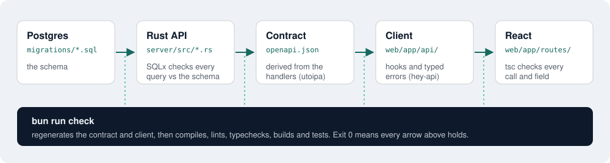
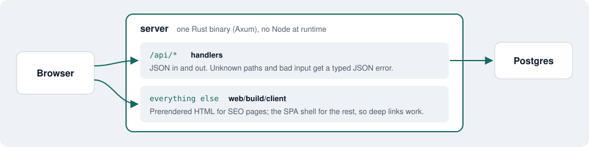

<h1>RR stack</h1>

<p>
  <a href="https://www.npmjs.com/package/create-rr-stack"></a>
  <a href="https://github.com/Useless007/rr-stack/actions/workflows/ci.yml"></a>
  <a href="LICENSE"></a>
</p>

[English](README.md) · **ไทย** · [简体中文](README.zh-CN.md) · [日本語](README.ja.md)

React Router + Rust (Axum) ที่ type ตรงกันตั้งแต่ฐานข้อมูลจนถึงหน้าจอ

```bash
bun create rr-stack my-app
```

RR stack คือโปรเจกต์ตั้งต้นสำหรับแอปที่ AI agent เป็นคนเขียน และคนเป็นคนตรวจ มีคำสั่งเดียวที่ตอบว่า
"งานเสร็จหรือยัง" คือ `bun run check` ถ้าจบด้วย exit 0 แปลว่า SQL, Rust API, สัญญา OpenAPI และโค้ด
React ตรงกันทั้งหมด ใช้ได้เหมือนกันบน Windows, macOS และ Linux

## ทำไมต้องมี

บั๊กส่วนใหญ่ที่ AI agent ทำหลุดไปคือสองชั้นไม่ตรงกัน เช่น เปลี่ยนชื่อคอลัมน์แล้ว client ยังส่งชื่อเดิม
หรือมี error รูปแบบที่ไม่มีใครรับ RR stack ย้ายปัญหาพวกนี้ไปเจอตอน compile ทั้งหมด

| ชั้น | เครื่องมือ | ใครตรวจ |
|---|---|---|
| ฐานข้อมูล | Postgres + SQLx `query!` | compiler ของ Rust เทียบกับ schema จริง |
| API | Axum + utoipa | `openapi.json` สร้างจาก handler อัตโนมัติ |
| สัญญา | `openapi.json` | สร้างใหม่และเทียบทุกครั้งที่รัน `bun run check` |
| Client | hey-api + TanStack Query | สร้างจากสัญญา รวมถึง error ที่มี type |
| UI | React Router (`ssr: false` + `prerender`) | `tsc` และ build เต็ม |

ตอนใช้งานจริงมี process เดียว Axum เสิร์ฟทั้ง API และหน้าเว็บที่ build แล้ว ไม่ต้องมี Node

## ทำงานอย่างไร





## ทำไมไม่ต่อเองทั้งหมด

ทำได้ ทุกชิ้นในนี้เป็นไลบรารียอดนิยมทั่วไป สิ่งที่เสียเวลาจริงคือการต่อแต่ละชิ้นเข้าหากัน และนั่นคือสิ่งที่
repo นี้ทำไว้ให้

| ถ้าทำเองต้อง | RR stack มีให้แล้ว |
|---|---|
| ดึง OpenAPI spec ออกจาก Rust โดยไม่ต้องเปิด server | `cargo run --bin openapi` สร้างจาก router ตัวเดียวกับที่ server ใช้ |
| สร้าง TS client และ react-query hooks แล้วให้ CI ล้มเมื่อไม่ตรงกัน | `bun run gen` และการเทียบสัญญาใน `bun run check` |
| build Rust ใน CI และ Docker โดยไม่มีฐานข้อมูล | metadata ของ query แบบ offline ใน `.sqlx/` ที่ commit ไว้ |
| ตอบ error เป็น JSON ที่มี type แทนข้อความธรรมดา เมื่อ input ผิดหรือไม่มี route | `AppJson`, `AppPath`, `AppQuery` และ JSON 404/405 |
| เสิร์ฟหน้า prerender, SPA และ API จาก binary เดียว | Axum พร้อม SPA fallback มี test เรื่องเปิดลิงก์ตรง |
| ใช้คำสั่งชุดเดียวกันบน Windows และ Linux | สคริปต์ bun, ขึ้นบรรทัดแบบ LF, CI ทั้งสองระบบ |
| บอก AI agent ว่า "เสร็จ" คืออะไร และห้ามแตะไฟล์ไหน | `AGENTS.md` และคำสั่งตรวจคำสั่งเดียว |
| ระบบ login ที่ปลอดภัยตั้งแต่ต้น | hash ด้วย Argon2id, cookie แบบ HttpOnly SameSite, เก็บ session token แบบ hash, ตรวจเจ้าของใน SQL |
| ส่งการเปลี่ยนแปลงไปยังหน้าที่เปิดอยู่ | WebSocket ที่ชนิดของข้อความอยู่ในสัญญา client จึงมี type |
| เปิดทุกอย่างด้วยคำสั่งเดียว | `bun run dev` หรือ `docker compose up -d` |

แต่ละแถวกินเวลาอ่าน docs และลองผิดลองถูกหลายชั่วโมงในครั้งแรก และพลาดแบบเนียนๆ ได้ง่าย เช่น client
ที่ CI ไม่เคย generate ใหม่ หรือ fallback ที่ตอบ `/api/พิมพ์ผิด` เป็น HTML ที่นี่ทุกแถวมี test คุมไว้

**ต่อยอดได้อีก**

- อยากให้ search engine เห็นหน้าไหน ใส่ path ไว้ใน `prerender` ของ `web/react-router.config.ts`
  หน้านั้นจะออกมาเป็น HTML แบบ static ส่วนการ render ฝั่ง server ทุก request (`ssr: true`) ยังไม่ได้
  ทำไว้ให้ ทำได้โดยรัน server ของ React Router คู่กับ Axum
- มี backend ภาษาอื่นอยู่แล้ว ฝั่งเว็บอ่านแค่ `openapi.json` backend ไหนที่ออก OpenAPI spec ได้ก็ใช้
  client และ hooks ที่ generate ชุดเดียวกันนี้ได้
- ไม่เคยเขียน Rust ก็ได้ agent เป็นคนเขียน compiler บอก agent ว่าต้องแก้ตรงไหน และ `bun run check`
  บอกคุณว่างานเสร็จหรือยัง

## เริ่มใช้งาน

```bash
bun create rr-stack my-app
cd my-app
docker compose up -d     # รันทั้งแอปโดยไม่ต้องลงเครื่องมือ CLI จะบอก URL ให้
# หรือถ้าจะพัฒนาต่อ:
bun run dev              # Postgres ใน Docker + Rust API + Vite พร้อม hot reload
```

โปรเจกต์ใหม่เป็นเว็บเล็กๆ ที่ใช้งานได้จริงเกี่ยวกับ stack นี้ มีหน้าที่ prerender, หน้า API reference
ที่สร้างจากสัญญา ระบบ sign-in และ playground ที่ทำ CRUD ครบ กรองและค้นหาได้ อัปเดตแบบ optimistic
อัปเดตสดผ่าน WebSocket และมี error 401/403/404/422 ที่มี type อ่านขั้นตอนการทำงานประจำวันได้ใน `README.md` และ `AGENTS.md` ของโปรเจกต์

สิ่งที่ต้องมี: Docker ถ้าจะพัฒนาต้องมี Rust (stable), [bun](https://bun.sh), git และ
`cargo install sqlx-cli --no-default-features --features postgres,rustls` เพิ่ม

## repo นี้

repo นี้เป็นสองอย่างในตัวเดียว

- **template** ทุกอย่างนอก `cli/` และ `docs/` คือโปรเจกต์ RR stack ที่ใช้งานได้ และเป็นสิ่งที่
  `bun create rr-stack` คัดลอกไป จึงรัน ทดสอบ และแก้ได้เหมือนโปรเจกต์ที่สร้างขึ้นมา
- **CLI** `cli/` คือ package `create-rr-stack` บน npm ตอน publish จะแพ็ก template (เฉพาะไฟล์ที่ git
  track) และ README ของโปรเจกต์จาก `cli/project-readme.md`

```
server/                Rust API (Axum, utoipa, SQLx) และ integration test
web/                   แอป React Router; web/app/api/ เป็นไฟล์ที่ generate
scripts/               สคริปต์ bun ที่อยู่เบื้องหลัง bun run dev / check / smoke / gen
cli/                   create-rr-stack: index.ts (คำถาม), scaffold.ts (คัดลอก + เปลี่ยนชื่อ), test
openapi.json           สัญญาที่ generate
.github/workflows/     CI บน Linux และ Windows กับ docker compose; ติดไปกับโปรเจกต์ใหม่ด้วย
```

## ร่วมพัฒนา

ยินดีรับทั้งจากคนและจาก agent ที่ทำงานแทนคน เริ่มที่ [CONTRIBUTING.md](CONTRIBUTING.md)
(ภาษาอังกฤษ) สรุปสั้นๆ

1. งานที่ใหญ่กว่าการแก้บั๊ก ให้เปิด issue ก่อน จะได้ตกลงรูปแบบกันก่อนลงมือ
2. `bun run check` ต้องจบด้วย exit 0 CI จะรันให้บน Linux และ Windows
3. ถ้าแก้ template ให้รัน `bun test` ใน `cli/` ด้วย มันจะสร้างโปรเจกต์แล้วตรวจให้
4. ฉบับภาษาอังกฤษคือต้นฉบับ ถ้าแก้แล้วยังไม่ได้แปลตาม ให้บอกใน PR ว่าภาษาไหนต้องอัปเดต

## License

[MIT](LICENSE)
