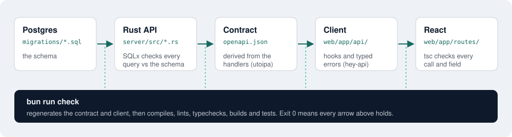
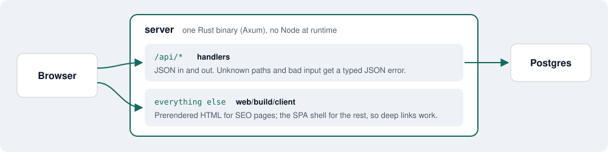

<h1>RR stack</h1>

<p>
  <a href="https://www.npmjs.com/package/create-rr-stack"></a>
  <a href="https://github.com/Useless007/rr-stack/actions/workflows/ci.yml"></a>
  <a href="LICENSE"></a>
</p>

[English](README.md) · [ไทย](README.th.md) · **简体中文** · [日本語](README.ja.md)

React Router + Rust (Axum)，从数据库到界面全程类型一致。

```bash
bun create rr-stack my-app
```

RR stack 是一个项目起步模板，适合由 AI agent 编写代码、由人来审查的应用。只需一条命令
`bun run check` 就能回答"做完了吗？"。退出码为 0，就说明 SQL、Rust API、OpenAPI 契约和 React
代码彼此一致。在 Windows、macOS 和 Linux 上用法完全相同。

## 为什么

AI agent 引入的大多数 bug，本质上是两层之间不一致：改了列名、客户端还在发送旧字段、没人处理的
错误格式。RR stack 把这些问题都提前到编译期：

| 层 | 工具 | 由谁检查 |
|---|---|---|
| 数据库 | Postgres + SQLx `query!` | Rust 编译器，对照真实 schema |
| API | Axum + utoipa | `openapi.json` 由 handler 自动生成 |
| 契约 | `openapi.json` | 每次 `bun run check` 都重新生成并比对 |
| 客户端 | hey-api + TanStack Query | 由契约生成，包括带类型的错误 |
| UI | React Router（`prerender` + SPA，或使用 `--ssr` 时的 `ssr: true`） | `tsc` 和完整构建 |

默认情况下生产环境只有一个进程：Axum 同时提供 API 和构建好的页面，运行时不需要 Node。
用 `bun create rr-stack my-app --ssr` 创建时，每个页面都在服务端渲染，在 Axum 后面多一个 bun 进程。

## 工作原理





## 为什么不自己拼起来？

当然可以。这里的每个部件都是常见的流行库。真正耗时的是把它们粘在一起，而这正是这个仓库提供的：

| 自己做需要 | RR stack 已经提供 |
|---|---|
| 不启动服务器就从 Rust 导出 OpenAPI spec | `cargo run --bin openapi`，与服务器运行时使用同一个 router |
| 生成 TS 客户端和 react-query hooks，并在不一致时让 CI 失败 | `bun run gen`，以及 `bun run check` 中的契约比对 |
| 在 CI 和 Docker 中无需数据库就能构建 Rust | 已提交的 `.sqlx/` 离线查询元数据 |
| 对错误输入和未知路由返回带类型的 JSON，而不是纯文本 | `AppJson`、`AppPath`、`AppQuery` 以及 JSON 404/405 |
| 用一个二进制同时提供预渲染页面、SPA 和 API | 带 SPA fallback 的 Axum；深层链接有测试 |
| 让搜索引擎找到，分享时显示卡片 | canonical 链接、Open Graph 卡片、`sitemap.xml` 和 `robots.txt` 都来自同一份公开页面列表；私有页面带 `noindex`；`--ssr` 返回真正的 404 |
| 在 Windows 和 Linux 上使用同一套命令 | bun 脚本、LF 换行、两个系统都跑 CI |
| 告诉 AI agent 什么叫"完成"、哪些文件不能动 | `AGENTS.md` 和一条检查命令 |
| 默认安全的登录 | Argon2id 哈希、HttpOnly SameSite cookie、只存哈希的会话令牌、在 SQL 中检查所有者 |
| 把变更推送到已打开的页面 | 消息类型写在契约里的 WebSocket，客户端同样有类型 |
| 一条命令启动全部 | `bun run dev`，或 `docker compose up -d` |

每一行第一次做都要花几个小时查文档、反复试错，而且很容易出现隐蔽的错误：CI 从不重新生成的客户端、
把 `/api/拼错` 当作 HTML 返回的 fallback。这里每一行都有测试保护。

**进一步扩展**

- 想要现成的组件库？加上 `--astryx`，应用页面会用 [Astryx](https://github.com/meta/astryx)
  （Meta 的 React 设计系统，beta）构建，与 Tailwind 一起使用。
- 想让搜索引擎看到某个页面？把它的路径加到 `web/react-router.config.ts` 的 `prerender` 里，它就会
  以静态 HTML 发布。需要首屏 HTML 就带上每个访客的数据？用 `--ssr` 创建应用，路由的 `loader` 会在
  服务端运行（todo 页面就是示例）。
- 已经有其他语言的后端？Web 端只读取 `openapi.json`，任何能输出 OpenAPI spec 的后端都能驱动同一套
  生成的客户端和 hooks。
- 没写过 Rust？代码由 agent 来写，编译器会告诉 agent 该改哪里，`bun run check` 会告诉你什么时候完成。

## 快速开始

```bash
bun create rr-stack my-app
cd my-app
docker compose up -d     # 运行整个应用，无需安装工具链；CLI 会打印访问地址
# 或者用于开发：
bun run dev              # Docker 中的 Postgres + Rust API + Vite，支持热更新
```

新项目本身就是一个介绍这个技术栈的小网站：预渲染页面、由契约生成的 API 参考，登录功能，以及一个包含
完整 CRUD、筛选、搜索、乐观更新、WebSocket 实时更新和带类型 401/403/404/422 错误的 playground。日常工作流程请看项目里的
`README.md` 和 `AGENTS.md`。

环境要求：Docker。开发还需要 Rust（stable）、[bun](https://bun.sh) 1.4+、git，以及
`cargo install sqlx-cli --no-default-features --features postgres,rustls`。

## 关于这个仓库

这个仓库同时是两样东西：

- **模板。** `cli/` 和 `docs/` 以外的所有内容就是一个可运行的 RR stack 项目，也就是
  `bun create rr-stack` 复制的内容，所以可以像生成的项目一样运行、测试和修改。
- **CLI。** `cli/` 是 npm 上的 `create-rr-stack` 包。发布时会打包模板（仅 git 跟踪的文件）以及
  `cli/project-readme.md` 中的项目 README。

```
server/                Rust API（Axum、utoipa、SQLx）及其集成测试
web/                   React Router 应用；web/app/api/ 为生成代码
scripts/               bun run dev / check / smoke / gen 背后的 bun 脚本
cli/                   create-rr-stack：index.ts（交互提示）、scaffold.ts（复制与重命名）、测试
openapi.json           生成的契约
.github/workflows/     Linux 和 Windows 上的 CI 以及 docker compose；会复制到新项目中
```

## 参与贡献

欢迎贡献，无论来自人还是替人工作的 agent。请先阅读 [CONTRIBUTING.md](CONTRIBUTING.md)（英文）。
简要来说：

1. 比修 bug 更大的改动，请先开 issue，先就方案达成一致。
2. `bun run check` 必须以 0 退出。CI 会在 Linux 和 Windows 上运行它。
3. 修改了模板？还要在 `cli/` 中运行 `bun test`，它会生成一个项目并进行检查。
4. 英文版是原文。如果改动后翻译尚未同步，请在 PR 中注明哪些语言需要更新。

## 许可证

[MIT](LICENSE)
